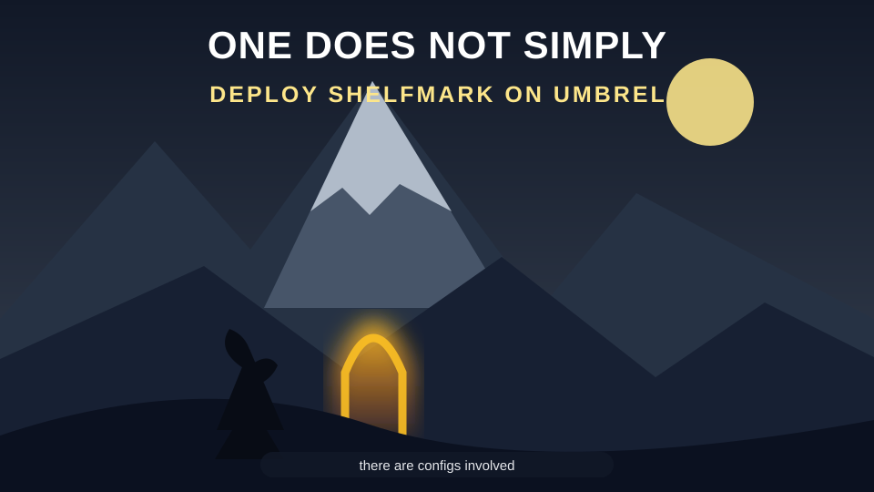

# Shelfmark for Umbrel

This is a test build of Shelfmark for Umbrel.

This build was vibecoded: assembled with AI prompts, human vibes, and a healthy respect for copy-paste.

All credit goes to the [original Shelfmark app](https://github.com/calibrain/shelfmark) and its developers. They cooked; this repo just put the plate in an Umbrel-shaped box. 🍽️

## Install on umbrelOS

1. Open the App Store on your umbrelOS device and add a community app store.
2. Enter this repository URL: `https://github.com/telskamp/shelfmark-umbrel`
3. Open the Telskamp App Store, select Shelfmark, and install it.

This is an independently maintained community package, not an official Umbrel App Store listing.
